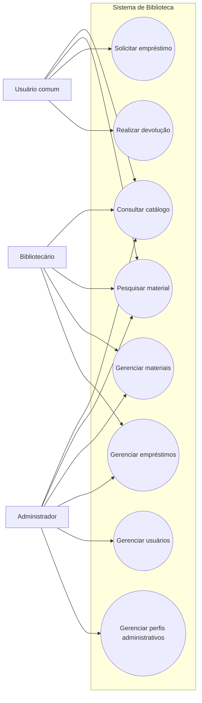

# UML — Sistema de Gerenciamento de Biblioteca

Este documento apresenta uma proposta inicial de diagrama de classes em Mermaid. O diagrama deve ser atualizado caso as decisões de implementação mudem.

## Diagrama de classes

```mermaid
classDiagram
direction TB

class Usuario {
  <<abstract>>
  -int id
  -String nome
  -String login
  -String senha
  +exibirDados()*
  +getId() int
}

class UsuarioComum {
  +exibirDados()
}

class Bibliotecario {
  +exibirDados()
}

class Administrador {
  +exibirDados()
}

Usuario <|-- UsuarioComum
Usuario <|-- Bibliotecario
Usuario <|-- Administrador

class MaterialBibliografico {
  <<abstract>>
  -int id
  -String titulo
  -int anoPublicacao
  -boolean disponivel
  +exibirDetalhes()*
  +podeSerEmprestado() boolean
  +alterarDisponibilidade(boolean) void
}

class Livro {
  -String autor
  -String isbn
  -String editora
  +exibirDetalhes()
  +podeSerEmprestado() boolean
}

class Revista {
  -String editora
  -int numeroEdicao
  -String dataPublicacao
  +exibirDetalhes()
  +podeSerEmprestado() boolean
}

class Jornal {
  -String editora
  -int numeroEdicao
  -String dataPublicacao
  +exibirDetalhes()
  +podeSerEmprestado() boolean
}

MaterialBibliografico <|-- Livro
MaterialBibliografico <|-- Revista
MaterialBibliografico <|-- Jornal

class Emprestimo {
  -int id
  -LocalDate dataEmprestimo
  -LocalDate dataPrevistaDevolucao
  -LocalDate dataDevolucao
  -StatusEmprestimo status
  +registrarDevolucao() void
  +estaAtivo() boolean
}

class StatusEmprestimo {
  <<enumeration>>
  ATIVO
  DEVOLVIDO
  ATRASADO
}

Emprestimo --> "1" Usuario : usuario
Emprestimo --> "1" MaterialBibliografico : material
Emprestimo --> StatusEmprestimo

class Repositorio~T~ {
  <<interface>>
  +adicionar(T) void
  +buscarPorId(int) T
  +listarTodos() List~T~
  +atualizar(T) void
  +remover(int) void
}

class UsuarioRepositorio {
  -List~Usuario~ usuarios
}

class MaterialRepositorio {
  -List~MaterialBibliografico~ materiais
}

class EmprestimoRepositorio {
  -List~Emprestimo~ emprestimos
}

Repositorio <|.. UsuarioRepositorio
Repositorio <|.. MaterialRepositorio
Repositorio <|.. EmprestimoRepositorio

class UsuarioService {
  -UsuarioRepositorio repositorio
  +cadastrar(Usuario) void
  +buscar(int) Usuario
  +listar() List~Usuario~
  +remover(int) void
}

class CatalogoService {
  -MaterialRepositorio repositorio
  +cadastrar(MaterialBibliografico) void
  +buscar(int) MaterialBibliografico
  +listar() List~MaterialBibliografico~
  +remover(int) void
}

class EmprestimoService {
  -EmprestimoRepositorio emprestimos
  -MaterialRepositorio materiais
  +realizarEmprestimo(Usuario, MaterialBibliografico) Emprestimo
  +registrarDevolucao(int) void
  +listarPorUsuario(int) List~Emprestimo~
}

UsuarioService --> UsuarioRepositorio
CatalogoService --> MaterialRepositorio
EmprestimoService --> EmprestimoRepositorio
EmprestimoService --> MaterialRepositorio
EmprestimoService ..> LimiteEmprestimosException
EmprestimoService ..> MaterialIndisponivelException

class LimiteEmprestimosException {
  <<exception>>
}

class MaterialIndisponivelException {
  <<exception>>
}
```

## Como interpretar

- **Herança:** setas com triângulo vazio (`<|--`) representam especialização. Os três perfis herdam de `Usuario`; os três materiais herdam de `MaterialBibliografico`.
- **Implementação de interface:** `<|..` indica que os repositórios concretos implementam `Repositorio<T>`.
- **Associação:** `Emprestimo` mantém referências a um usuário e a um material.
- **Dependência:** setas tracejadas indicam que um serviço utiliza ou depende de outro elemento.
- **Polimorfismo:** chamadas a `exibirDetalhes()` e `podeSerEmprestado()` podem ser feitas pela referência da classe-base.

## Observação sobre composição

O relacionamento entre `Emprestimo` e `Usuario`/`MaterialBibliografico` é uma **associação**, não composição: os usuários e materiais continuam existindo após o encerramento do empréstimo.

Para demonstrar composição de forma legítima, uma opção é criar a classe `Biblioteca` como responsável por manter seus repositórios, que são criados e administrados junto dela. Não force composição onde o ciclo de vida dos objetos não justificar esse relacionamento.

## Diagrama de casos de uso (visão simplificada)

Este segundo desenho é uma visão simplificada de funcionalidades e atores. As permissões reais devem ser verificadas no código, nos serviços.